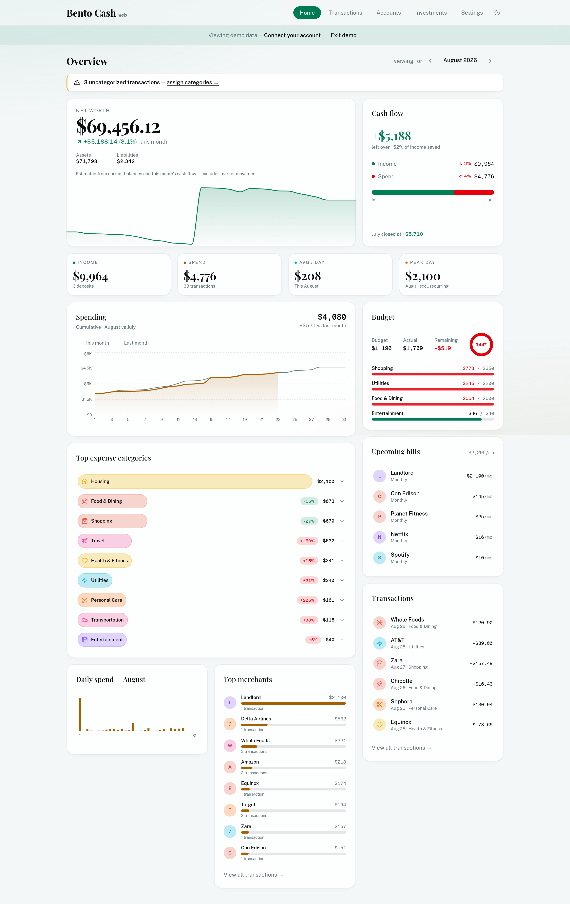
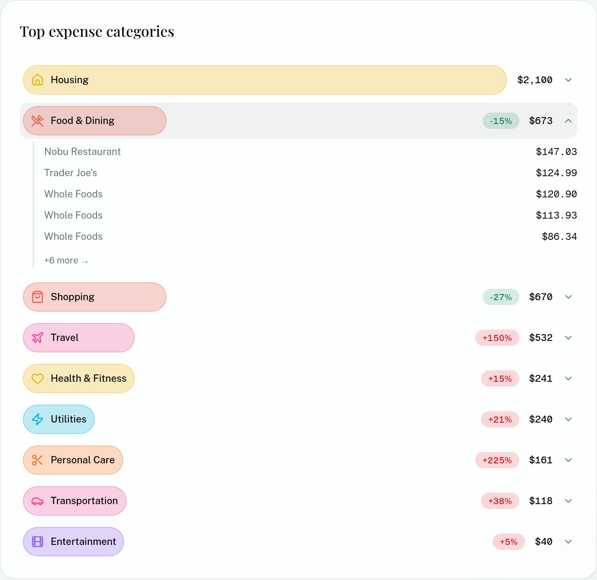
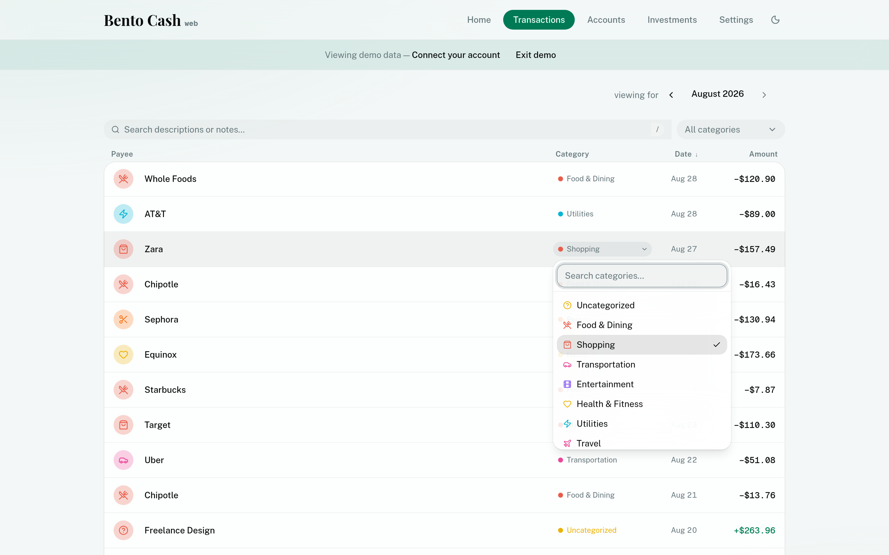
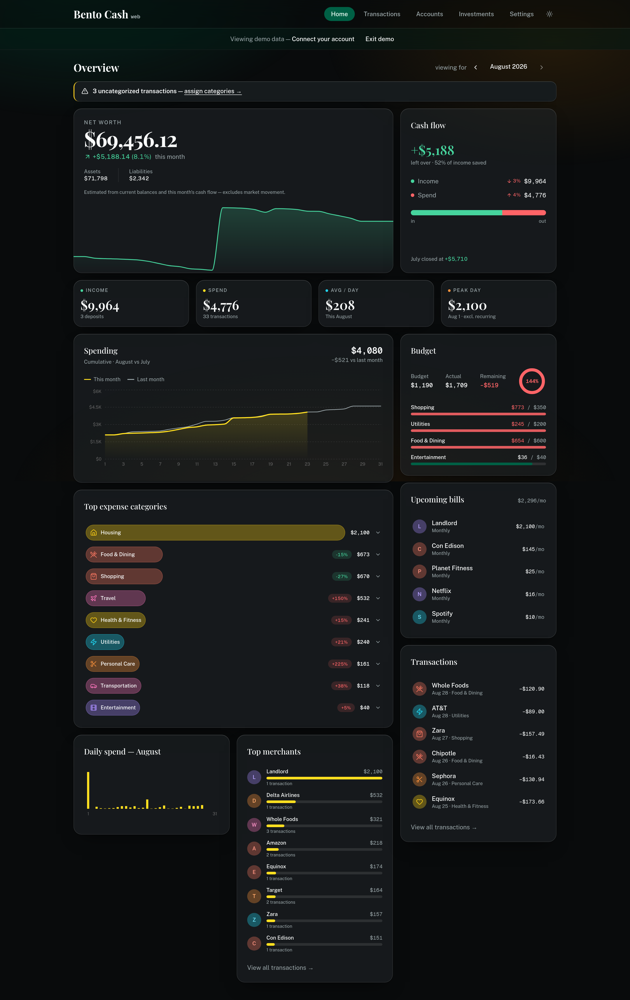

# Bento Cash

A richer analytics interface for [Lunch Money](https://lunchmoney.app) — faster daily-use, deeper spending insights, and a cleaner view of your financial picture than the native Lunch Money UI.

<picture>
  <source media="(prefers-color-scheme: dark)" srcset="screenshots/dark-mode.png">
  <source media="(prefers-color-scheme: light)" srcset="screenshots/light-mode.png">
  
</picture>

## Try the demo

No account needed — hit **Try Demo** from the home screen to explore with sample data.

## What it does

**Dashboard** — net worth, cash flow measured against last month, cumulative spending drawn against the previous month, budget progress, upcoming bills, and month-over-month deltas on every category. Expand any category to see the transactions behind it.



**Transactions** — searchable, filterable, sortable list for any month. Click a description to rename it, click a category to pick a new one from a searchable list, and expand a row for notes with explicit Save/Cancel controls. Month selection stays in the URL so dashboard drill-downs preserve context. Committed edits apply immediately and writes back to Lunch Money; a failed write rolls the row back and says so.

Keyboard: `/` focuses search, `[` and `]` step months, `Enter` takes the top match in the category picker. Under the Uncategorized filter, categorizing a row moves focus to the next one, so a queue clears without touching the mouse.



**Accounts** — net worth overview with assets and liabilities grouped by institution, covering Plaid-synced and manual accounts.

**Investments** — portfolio allocation and account breakdown across all investment accounts.

**Uncategorized alerts** — amber banner whenever transactions are missing a category, with a direct link to fix them.

## Dark and light mode

Press `d` or use the toggle in the header. Works across all pages.

<div align="center">
  
  
</div>

## How it works

Bento Cash uses Better Auth with Lunch Money OAuth and cookie sessions. Signing
in creates a Bento Cash account and connects the selected Lunch Money budget.
There is no Bento password to create or store. Users can authorize multiple
budgets and switch between them. OAuth credentials are encrypted at rest and
used only by authenticated server routes; they are never returned to the browser.

The data model separates the Lunch Money user from each authorized budget, so
features and preferences belong to a specific user and connection. Existing
Google-backed Bento accounts are linked when the verified email matches. See
[the auth architecture](docs/auth-architecture.md).

## Getting started

**Prerequisites:** Node.js 22.13+, pnpm, a
[Lunch Money](https://lunchmoney.app) account, and a confidential OAuth client
registered in the [Developer Portal](https://alpha.developers.lunchmoney.app/oauth/applications).

```bash
git clone https://github.com/your-username/bento-cash-web
cd bento-cash-web
pnpm install
pnpm dev
```

Copy `.env.example` to `.env.local`, set a high-entropy `BETTER_AUTH_SECRET`,
and add `LUNCH_MONEY_CLIENT_ID` and `LUNCH_MONEY_CLIENT_SECRET`. Use
`LUNCH_MONEY_OAUTH_ISSUER=https://api-alpha.lunchmoney.dev` for the OAuth
preview. Register `http://localhost:3000/api/auth/callback/lunch_money` and
the corresponding production HTTPS callback. Then run `pnpm dev`. This runs
vinext in Cloudflare's local Worker runtime with a locally persisted
SQLite-backed Durable Object. Committed migrations run when the object starts.

Open [http://localhost:3000](http://localhost:3000) and continue with Lunch Money.

`pnpm dev` runs the vinext development server on port 3000. `pnpm build`
produces both Cloudflare Workers. The app Worker's `BENTO_DB` binding points to
the database Worker's SQLite-backed `BentoDatabase` Durable Object. No R2 bucket
is required.
Local data is kept under `.cloudflare/state/`; deployed data is separate.
Migrations run when the Durable Object starts, both locally and in production.
Run `pnpm db:verify-migrations` to apply and verify them in an isolated local
SQLite database. The command does not access a running app or production data.
Local `pnpm dev` reads secrets from `.env.local`.

For automatic deployment on each push to the production branch, connect this
repository to **both** Workers in Cloudflare Workers Builds. Configure each
Worker with the repository root as its root directory:

| Connected Worker          | Build command | Deploy command                                                                      |
| ------------------------- | ------------- | ----------------------------------------------------------------------------------- |
| `bento-cash-web-database` | `pnpm build`  | `pnpm exec cf deploy --prebuilt --mode production --worker bento-cash-web-database` |
| `bento-cash-web`          | `pnpm build`  | `pnpm exec cf deploy --prebuilt --mode production`                                  |

Deploy the database Worker once before the app Worker's first deployment so the
`BENTO_DB` binding has a target. After that, pushes trigger both Workers Builds
independently. In the app Worker's **Settings > Variables & Secrets**, configure
`BETTER_AUTH_SECRET`, `LUNCH_MONEY_CLIENT_ID`,
`LUNCH_MONEY_CLIENT_SECRET`, `LUNCH_MONEY_OAUTH_ISSUER`, and
`BENTO_CREDENTIAL_ENCRYPTION_KEY` as runtime secrets. Build secrets are not
available to the deployed Worker.

GitHub Actions builds both Workers and dry-runs their deploy commands, then
verifies local Durable Object migrations. It does not deploy to Cloudflare.

### OAuth review environment

The `staging` build mode deploys `bento-cash-web-oauth-test` and
`bento-cash-web-oauth-test-database` as separate Workers. Its database and
sessions are isolated from the production Workers. Use the HTTPS test URL
`https://bento-cash-web-oauth-test.chintans98.workers.dev` for Lunch Money review;
add this exact callback to the OAuth client in the Developer Portal:

```text
https://bento-cash-web-oauth-test.chintans98.workers.dev/api/auth/callback/lunch_money
```

Create an ignored `.env.staging.local` containing `BETTER_AUTH_SECRET` (a new,
staging-only random value), `LUNCH_MONEY_CLIENT_ID`,
`LUNCH_MONEY_CLIENT_SECRET`, and
`LUNCH_MONEY_OAUTH_ISSUER=https://api-alpha.lunchmoney.dev`. Optionally add a
staging-only `BENTO_CREDENTIAL_ENCRYPTION_KEY`. Do not put secrets in the build
output or Git. From your test branch, run (sign in first with
`pnpm exec cf auth login` if needed):

```bash
pnpm exec cf build --mode staging
pnpm exec cf deploy --prebuilt --mode staging --worker bento-cash-web-oauth-test-database
pnpm exec cf deploy --prebuilt --mode staging --secrets-file .env.staging.local
```

Both staging deploy commands target only the test Workers. Rebuild and redeploy
the app Worker after code changes. The OAuth client remains owner-only while it
is in development; Lunch Money reviews the app after the client profile and
review request are submitted.

The registered client includes scopes for planned features. Lunch Money fixes
scopes at registration and asks for a feature-based explanation of each scope
in the review request.

If a dev server was already running when the Durable Object binding was added,
restart it once to load the new binding. Existing SQLite files and D1 databases
are not automatically imported into the Durable Object.

## Stack

- [vinext](https://vinext.dev) (App Router on Vite and Cloudflare Workers)
- [Tailwind CSS v4](https://tailwindcss.com) + [shadcn/ui](https://ui.shadcn.com)
- [Recharts](https://recharts.org)
- [`@lunch-money/lunch-money-js-v2`](https://github.com/lunch-money/lunch-money-js)

## License

MIT
